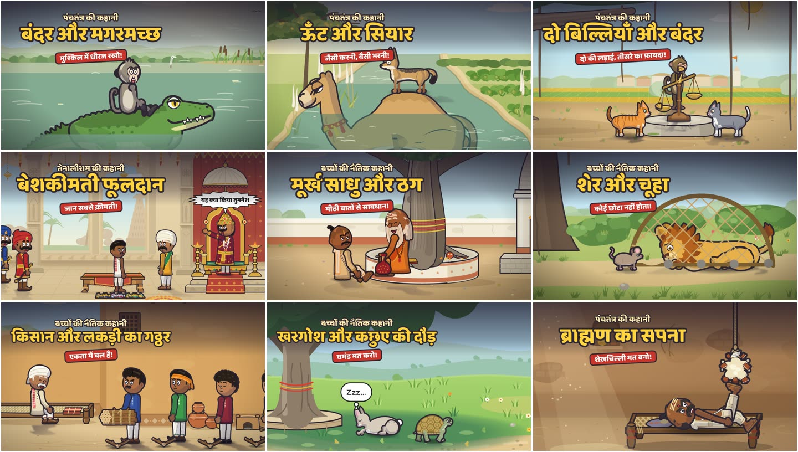

# talekit

**Goal: good-quality 2D films, reels and animations, made by AI agents with
this engine.**

The agent writes what it is fluent in (SVG fragments and JSON). The engine
owns what is hard to get right by hand: rigging, walks with planted feet,
follow-through, faces, bubble layout, camera, weather, sound and encoding.
Every write returns a picture, so the agent sees its output and fixes it.

```
story ──agent──▶ characters/*.json  scenes/*.json  shots/*.json ──talekit──▶ movie.mp4
                 (rigged SVG puppets) (SVG + anchors)  (timeline)
```

## Made with talekit

**Kahani ki Potli** is a channel of Hindi stories for children made entirely
with talekit: Panchatantra fables, Tenali Rama and other classic tales. Each
story is released as a full film and as a portrait reel of up to three
minutes, with Hindi and English subtitles.

[](https://www.youtube.com/@KahaniKiPotli7)

- YouTube: [@KahaniKiPotli7](https://www.youtube.com/@KahaniKiPotli7)
- Instagram: [@kahanikipotli7](https://www.instagram.com/kahanikipotli7/)

## Requirements

- Node 20+ and `ffmpeg` on the PATH (`brew install ffmpeg`). No browser:
  frames are rasterised with resvg.
- For voices: [uv](https://docs.astral.sh/uv/), an Apple Silicon Mac (the
  model runs on MLX) and `brew install espeak-ng` for Hindi. The first voiced
  line sets up `tools/tts/` (about 1.2 GB) and downloads the models (about
  3.2 GB). Without them everything works and lines are silent.
- For the speech check on voiced lines: `brew install whisper-cpp`. The first
  check downloads its model (about 570 MB) into `~/.cache/talekit/asr`.
  Without it, lines are voiced but not heard, and the voicing report says
  so.

## Quick start

```bash
npm install
npm run build
node dist/cli.js render examples/lost-kite   # → examples/lost-kite/out/movie.mp4 and .mkv
node dist/cli.js serve  examples/lost-kite --open   # review app at http://127.0.0.1:4848
claude mcp add talekit -- node /absolute/path/to/talekit/dist/cli.js mcp
```

Then, in a Claude Code session:

> Use talekit to turn this story into a video: _(paste story)_. Make a project
> in ~/stories/the-lost-kite.

The agent's first call should be `get_guide`, which returns
[docs/authoring-guide.md](docs/authoring-guide.md): the full contract for
characters, scenes and shots.

## Reviewing and output

`talekit serve <film> <reel> --open` (or `open_review`) serves the review
app for both from one server at http://127.0.0.1:4848, each project under
its own path. Pick a moment, click to pin a spot, and type a note; it is
saved to `<project>/notes.json`. Tell the agent "fix my notes": `list_notes`
gives it each note with the picture you saw, and `resolve_note` closes it
until you check it. The app reloads as the project
and the engine change. For a reel it shades the area the apps cover;
`--lan` serves it to a phone on the local network (no login, so only on a
trusted network). Sliders per sound layer save the `mix`, and **Save and
remix video** puts the new sound under the mp4 without drawing any frames.
A film with a sketch opens on its rendered video while that is up to date:
a sketch is drawn live only by running it from its shot's start.

Output: the film as `out/movie.mp4` plus `out/movie.mkv` (three sound
tracks, subtitles per language, a chapter per shot) and the **reel**, a
separate 720 × 1280 project (`talekit init <dir> --width 720 --height
1280`) that tells the story again in at most three minutes, mostly through
the narrator.

## What the agent writes

- **Character** — a rigged puppet: SVG per part (`head`, `torso`, `armL`…)
  drawn in the rig's fixed box, with variant maps for `mouth` and `eyes` and
  colour tokens (`{skin}`) for recolouring. Rigs: `humanoid`, `quadruped`
  (walks in diagonal pairs, gallops, sits, lies) and `simple` (birds, props).
- **Scene** — a background SVG with named floor **anchors**, the `walk`
  areas where feet can stand (and any `water`, `climb` and `solids`), optional
  `foreground`, `far` and `near` layers with parallax, `weather` and
  `effects` the engine animates, and `lights` that cast shadows.
- **Shot** — one scene, a cast, and timed actions: verbs (`walk`, `run`,
  `jump`, `sit`, `lie`, `pickup`…), `say` (speech, thought or shout; drives
  the mouth, and listeners look at the speaker), `emotion`, `attach` (carry
  a prop), `caption`, `camera` (including `follow`), `sound`, `set`. A shot
  can `crossfade` in. Every shot is played against the world (what stands
  on what, who faces whom, what reaches what), and its findings block the
  render until fixed or waived in the shot's `allow`.
- **Sound** — a `voice` per character, a narrator for captions, music, and
  scene `ambience`. Footsteps, rain, fire, thunder and the like come from
  what is on screen.

A project is a plain directory:

```
my-story/
  talekit.json        title, size, fps, music, narrator, mix
  characters/*.json
  scenes/*.json
  shots/NN-*.json     play in filename order
  audio/              the project's own sound files; voices/ caches spoken lines
  out/                renders and previews (git-ignored)
```

An agent can also write a film from scripts kept in the project's `src/`.
The Python kit in `kit/` (a wardrobe of Indian dress, voice-paced shot
helpers and templates) is the code those scripts share. See "Writing it from
scripts" in the guide.

## MCP tools

| tool                       | returns                                                                  |
| -------------------------- | ------------------------------------------------------------------------ |
| `get_guide`                | the authoring guide (read first)                                         |
| `create_project`           | a new project directory                                                  |
| `project_info`             | characters, scenes, shots, validation problems, open review notes        |
| `list_library`             | built-in characters and scenes (park, jungle, pond and others)           |
| `get_library_item`         | the JSON of a built-in, to learn a rig's layout before drawing           |
| `copy_from_library`        | copies a built-in with a new id, name, colours or anchors; its sheet     |
| `write_character`          | validates, saves, returns a **pose sheet** and a **construction sheet**  |
| `write_scene`              | validates, saves, returns the scene with **anchors marked**              |
| `write_shot`               | validates, checks the world, saves, returns a **contact sheet**          |
| `patch_shot`               | changes fields, cast or actions of a saved shot without rewriting it     |
| `get_item` / `delete_item` | read back or remove one file                                             |
| `preview_frame`            | one frame at a time `t`, optional debug markers                          |
| `preview_shot`             | contact sheet of a shot                                                  |
| `list_voices`              | voices for characters and the narrator, by language                      |
| `list_sounds`              | bundled music, ambience and sound effects                                |
| `set_audio`                | sets the music, narrator and mix, returns a **map of the film's sound**  |
| `critique`                 | the critic's checklist and read-through, or a shot's frames at its beats |
| `render`                   | mp4 of one shot or the whole film, plus a **film sheet** (frame/shot)    |
| `open_review`              | the review app for the film, the reel or a board of samples              |
| `list_notes`               | review notes left in the app, each with the frame or sheet it points at  |
| `resolve_note`             | marks a note done once the fix is in                                     |

## CLI

```
talekit init <dir> --title "…"       talekit sheet <dir> <id>
talekit check <dir> [--frames dir]   talekit frame <dir> <shot> -t 2.5 [--debug] [--svg]
talekit library                      talekit contact <dir> <shot> -n 6
talekit copy <dir> <libraryId>       talekit render <dir> [shot] [--silent]
talekit serve <dir> [dir…] [--open] [--lan]
                                     talekit voice <dir> [shot]
talekit explain <dir> [shot]         talekit remix <dir> [-o file.mp4]
talekit critic <dir> [shot] [-o dir] talekit mkv <dir> [-o file.mp4]
talekit mcp
talekit cover <dir> <shot> -t 3 --title "…"   (out/thumbnail.png)
talekit cover <dir> <shot> -t 3 --title "…" --banner   (out/banner.png, 2560 × 1440)
```

`talekit --help` prints every option.

## How it works

`src/engine` is pure: `composeFrame(project, shot, t)` returns an SVG
string, and the sound is a cue sheet computed the same way. `src/render`
rasterises with resvg on worker threads, streams raw frames into ffmpeg
(libx264), mixes the sound in JS and muxes it as AAC; a minute of 720p
renders in about ten seconds on an M-series Mac. Lines are spoken by a
Python sidecar on MLX (`tools/tts/`) and cached in the project, so a render
is the same every time and needs no model once the lines exist. The module
layout is in [CLAUDE.md](CLAUDE.md); the design decisions and their reasons
are in [docs/PLAN.md](docs/PLAN.md).

Latin text uses system fonts (the default stack starts with Chalkboard SE),
so output can differ slightly between machines. Hindi (Devanagari) is shaped
with HarfBuzz in the bundled Baloo 2 (`fonts/`, SIL Open Font License),
because the rasteriser misplaces its vowel signs.

## Development

```bash
npm run typecheck
npm test
npm run format
```
